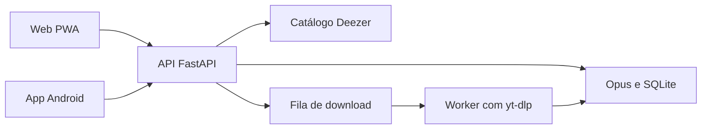

# RutsFy

Player de música com catálogo, biblioteca por conta e dois clientes sobre a mesma API. O site é uma PWA. O Android é um app nativo. Os dois entram com a mesma conta, leem a mesma biblioteca e tocam o áudio que o servidor já guardou.

Instância em produção: [ruts.dev/rutsfy](https://ruts.dev/rutsfy/).

O catálogo (busca, explorar, artista, álbum, playlist) vem da API pública do Deezer e traz só metadados. O áudio não vem de lá. Quando alguém toca uma faixa que ainda não está no servidor, o backend localiza um vídeo correspondente, baixa o áudio em Opus e passa a servi-lo do disco. A reprodução seguinte não baixa de novo.

## O que a aplicação faz

- Conta por apelido e senha, sessão em cookie HttpOnly, perfil e avatar.
- Biblioteca da conta, playlists criadas pelo usuário e atalhos para artista, álbum ou playlist.
- Explorar com lançamentos, gêneros e playlists.
- Busca por artista, álbum ou faixa.
- Histórico do que a conta ouviu.
- Fila e tela de reprodução no site. No Android, playback com Media3, notificação e tela bloqueada.
- Painel administrativo com usuários e estatísticas de uso.

Faixas novas acima de 20 minutos não entram na biblioteca. Arquivos que já estão no disco continuam disponíveis. Há também um teto de tamanho: o que passa do limite é registrado e não volta a ser tentado.

## Arquitetura



A API é um processo FastAPI. Usuários, sessões, preferências, cache de catálogo e a fila de download ficam em SQLite, no mesmo volume dos arquivos de áudio. O site é HTML, CSS e JavaScript servidos pelo próprio backend, com manifest e service worker. O app Android consome os mesmos endpoints.

Em produção a API sobe em Docker, atrás de um proxy, no prefixo `/rutsfy`. O download pesado não roda nesse processo: a API enfileira o pedido e um worker em outra máquina pega o job, baixa o áudio, envia o arquivo e apaga a cópia local. Dá para rodar o mesmo fluxo na máquina de desenvolvimento, com o yt-dlp local.

## Stack

| Parte | Tecnologia |
| --- | --- |
| API | Python 3.12, FastAPI, Uvicorn, Pydantic Settings, httpx |
| Dados | SQLite, arquivos Opus no disco |
| Áudio | yt-dlp e FFmpeg |
| Web | HTML, CSS e JavaScript, PWA |
| Android | Kotlin, Jetpack Compose, Media3, OkHttp, Coil. minSdk 26, compileSdk 35 |
| Deploy | Docker. A imagem da API inclui FFmpeg |

## Decisões

**Catálogo e áudio são passos separados.** Navegar e buscar não gasta a cota da YouTube Data API. Essa cota fica para mixes, página de canal e a busca antiga, que ainda existem na API. Respostas da Data API ficam em cache, e mais de uma chave entra em rotação quando a principal esgota.

**A faixa do catálogo vira um vídeo só na hora de tocar.** A resolução usa o yt-dlp, sem `search.list`, e o `videoId` fica em cache. O arquivo salvo é Opus. Capa, duração e crédito do artista são normalizados antes de chegar na interface.

**A fila de download tolera queda do worker.** O worker faz claim, envia heartbeat e devolve o arquivo. Sem sinal por três minutos, o job volta para pendente. Ao subir, o worker libera o que tinha pego e não terminou.

**A conta é própria, sem provedor externo.** Senha com PBKDF2-HMAC-SHA256, sessão opaca de 30 dias e uma sessão ativa por login. Preferências (playlists e atalhos) ficam no banco da conta, não no navegador.

**Os dois clientes compartilham o contrato.** O site e o Android usam os mesmos recursos de sessão, biblioteca, catálogo e stream. O Android publica o APK junto da API, com `versionCode`, e o app instalado compara a versão e oferece a atualização.

## Repositório

```text
backend/app/        API, autenticação, catálogo, download e fila
backend/static/     interface web
android/            cliente Android
scripts/            build do APK, deploy e worker de download
docker-compose.yml  ambiente antigo de rede local
docker-compose.prod.yml
```

Módulos centrais da API: `main.py` (rotas), `auth.py` e `users_db.py` (conta), `deezer_catalog.py` e `deezer_resolve.py` (catálogo e vínculo com o vídeo), `downloader.py` (arquivo em disco), `download_relay.py` (fila).

## Executar localmente

Requer Python 3.12, FFmpeg e o yt-dlp no PATH.

```bash
cd backend
python -m venv .venv
.venv\Scripts\activate
pip install -r requirements.txt
copy .env.example .env
uvicorn app.main:app --reload --host 127.0.0.1 --port 8090
```

No Linux ou macOS, a ativação é `source .venv/bin/activate` e a cópia do exemplo é `cp .env.example .env`.

Abra `http://127.0.0.1:8090`. O catálogo Deezer funciona sem chave. `YOUTUBE_API_KEY` no `.env` só é necessária para a YouTube Data API. Com `DOWNLOAD_MODE=local`, o áudio é baixado nesta máquina.

Variáveis e comentários estão em `backend/.env.example`. O arquivo `.env` não entra no repositório.
